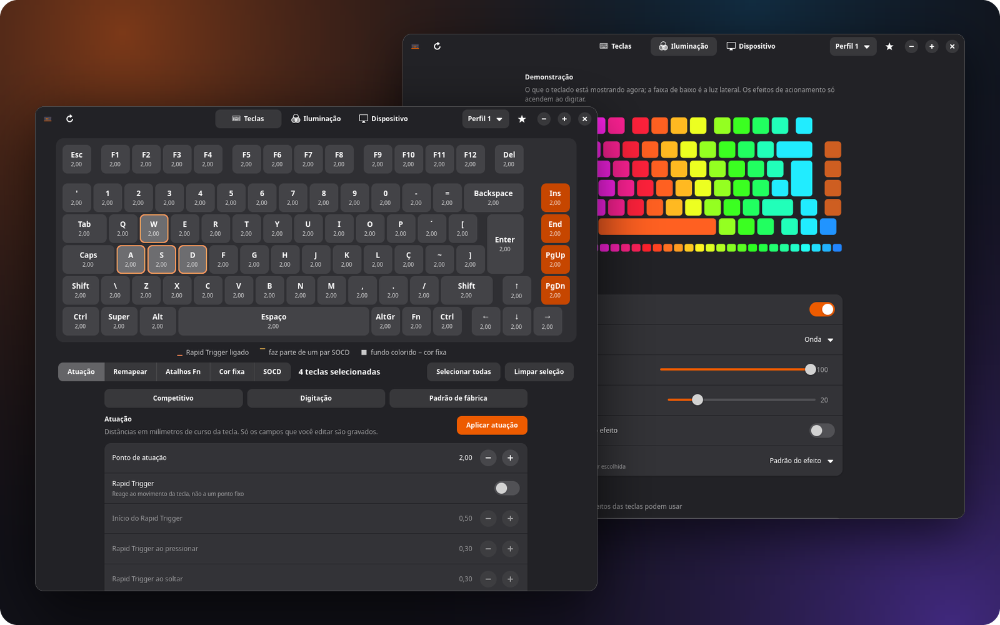
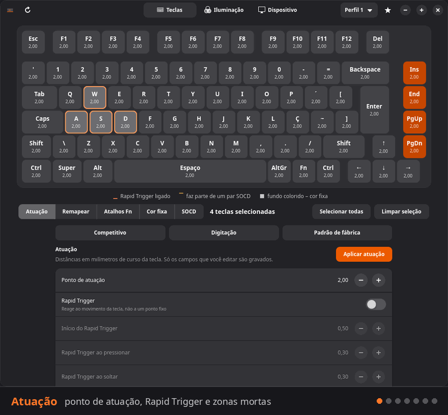
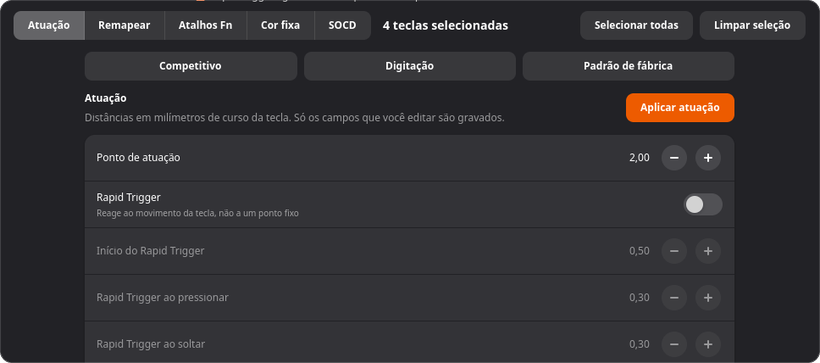
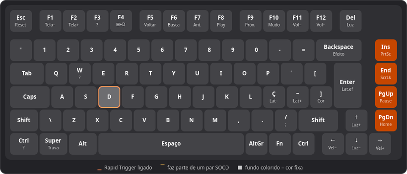
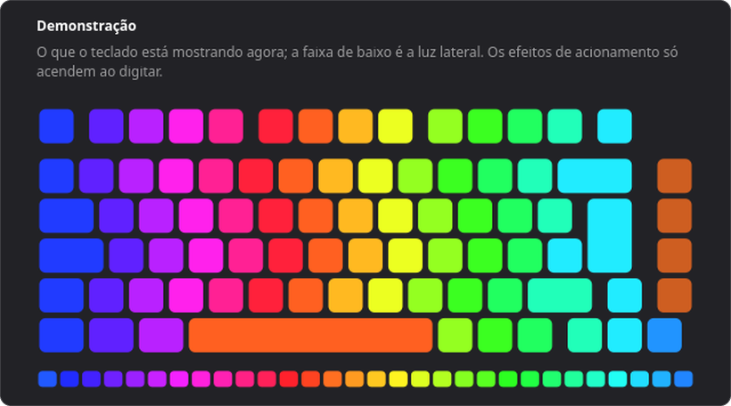
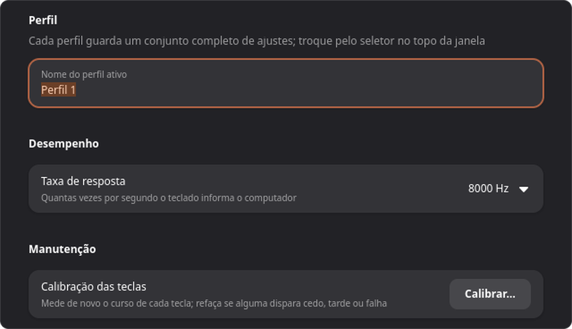
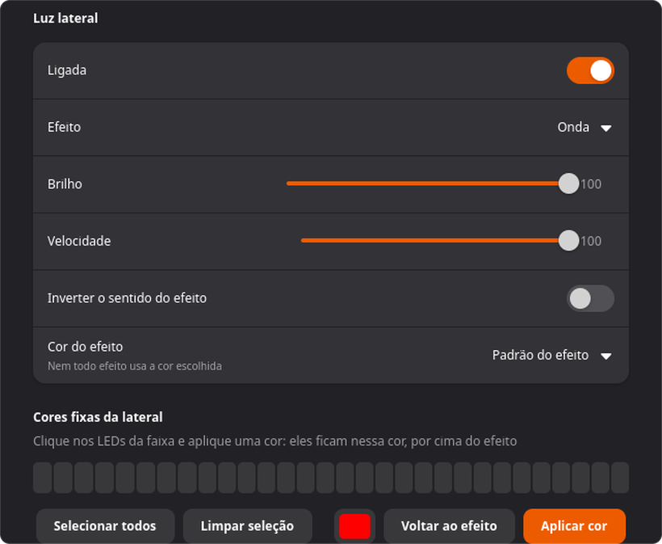
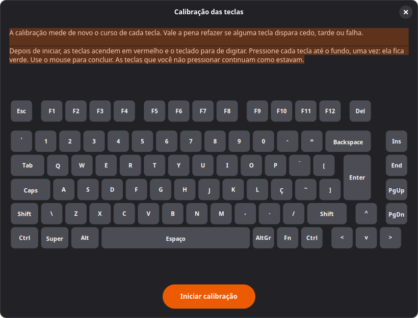
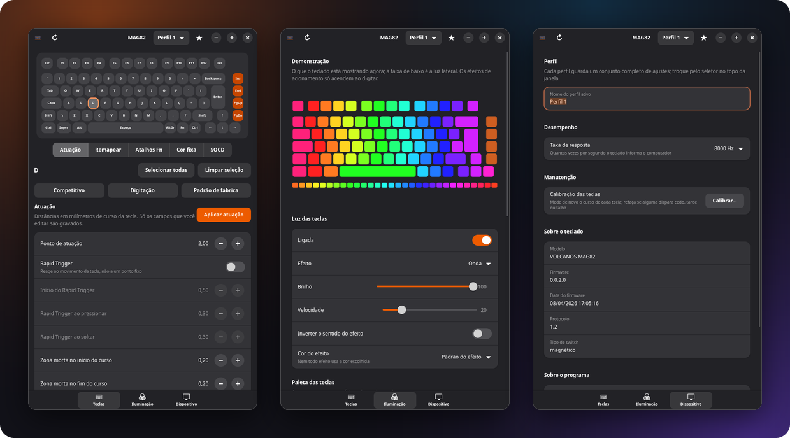

<h1 align="center">MAG82 para Linux</h1>

<p align="center">
  <b>O configurador que faltava para o Avell Volcano's MAG82 no Linux.</b><br>
  Atuação, Rapid Trigger, remapeamento, atalhos Fn, SOCD, DKS, RGB, perfis e calibração.<br>
  Nativo, em GTK 4, sem root.
</p>

<p align="center">
  <a href="LICENSE"></a>
  
  <a href="https://github.com/julianol1berato/Avell-MAG/releases"></a>
  
</p>

<p align="center">
  
</p>

O **Avell Volcano's MAG82** é um ótimo teclado magnético, mas o aplicativo dele só existe para
Windows. Este projeto resolve isso: uma interface gráfica e uma linha de comando nativas para
configurar o teclado no Linux.

> Projeto independente, mantido pela comunidade. **Sem vínculo com a Avell.**
> O programa grava configurações no teclado; use por sua conta.

**Tem um MAG82 e usa Linux?** [Instale](#instalação), use e conte como foi.
Cada relato, de problema ou de "funcionou aqui", ajuda o próximo que chegar.

## Um passeio pelas telas

<p align="center">
  
</p>

Três páginas, tudo à mão:

- **Teclas**: clique (ou arraste) no teclado, escolha o que mudar, aplique.
- **Iluminação**: luz das teclas e da faixa lateral, com o resultado na tela.
- **Dispositivo**: perfis, taxa de resposta, calibração e firmware.

O programa percebe sozinho quando o teclado é conectado, desconectado ou troca de perfil.
E a interface só mostra o que o teclado confirmou.

## O que ele faz

<p align="center">
  
</p>

<table>
  <tr>
    <td width="50%" valign="top">
      
      <h3>Atuação e Rapid Trigger</h3>
      Ponto de atuação, Rapid Trigger e zonas mortas, em milímetros.<br>
      Por tecla ou em lote.<br>
      Predefinições prontas: competitivo, digitação e padrão de fábrica.
    </td>
    <td width="50%" valign="top">
      
      <h3>Atalhos Fn e remapeamento</h3>
      Os 31 atalhos de fábrica aparecem no próprio teclado.<br>
      Mude qualquer um, ou crie os seus.<br>
      Remapeie o que cada tecla envia e volte ao padrão quando quiser.
    </td>
  </tr>
  <tr>
    <td width="50%" valign="top">
      
      <h3>Iluminação com demonstração ao vivo</h3>
      Efeito, brilho, velocidade, sentido e paleta de sete cores.<br>
      A demonstração mostra o que o teclado está fazendo agora.<br>
      Cor fixa por tecla, por cima do efeito.
    </td>
    <td width="50%" valign="top">
      
      <h3>Perfis e desempenho</h3>
      Troque e renomeie perfis.<br>
      Ajuste a taxa de resposta.<br>
      Veja modelo e firmware do teclado.
    </td>
  </tr>
  <tr>
    <td width="50%" valign="top">
      
      <h3>Faixa lateral</h3>
      Efeitos, brilho e velocidade próprios.<br>
      Cor fixa por LED: clique nos LEDs e aplique.
    </td>
    <td width="50%" valign="top">
      
      <h3>Calibração com registro</h3>
      Mede de novo o curso de cada tecla.<br>
      Cada tecla fica verde quando termina.<br>
      Tudo anotado em um registro, para consultar depois.
    </td>
  </tr>
</table>

E mais:

- **SOCD** para teclas opostas (A/D, W/S): vale a última, uma delas sempre vence, ou nenhuma.
- **DKS**: até quatro funções na mesma tecla, acionadas em pontos diferentes do curso.
- **Linha de comando** com tudo o que a interface faz.
- **Sem root**: roda como usuário comum.

A janela se ajusta ao espaço que tiver:

<p align="center">
  
</p>

## Instalação

Baixe o pacote na [página de versões](https://github.com/julianol1berato/Avell-MAG/releases) e
instale com dois cliques, ou pelo terminal:

```sh
sudo apt install ./mag82_*.deb     # Ubuntu, Debian, Mint, Pop!_OS
sudo dnf install ./mag82-*.rpm     # Fedora
```

Depois é só procurar por **MAG82** no menu.

Duas coisas que vale saber:

- A instalação pede senha porque precisa liberar o acesso ao teclado (uma regra udev).
  **O programa roda como usuário comum, sem root.**
- Se o teclado já estava conectado e o programa reclamar de permissão, tire e ponha o cabo.

Requisitos: GTK 4.12 e libadwaita 1.5 ou mais novos.
Na prática: Ubuntu 24.04, Debian 13 e Fedora 43 em diante.

### Tamanho da tela

- **Recomendado:** tela de 1280 × 800 ou maior. A janela abre em 1020 × 880 e mostra o teclado e os
  ajustes sem precisar rolar.
- **Mínimo:** a janela encolhe até 540 × 580. Nesse tamanho as abas vão para o rodapé, os nomes dos
  modos encurtam e a legenda some; os ajustes continuam todos lá, rolando abaixo do teclado.
- **Abaixo disso** o programa não cabe: em uma tela menor que 540 × 580 parte da janela fica fora dela.

### A partir do código

```sh
sudo apt install cargo libgtk-4-dev libadwaita-1-dev     # Ubuntu, Debian
sudo dnf install cargo gtk4-devel libadwaita-devel       # Fedora

scripts/instalar-local.sh
```

O script compila e instala tudo em `~/.local`, sem root.
A regra udev é o único passo que pede senha, e só na primeira vez.

## Atualizações

Ao abrir, o programa confere se saiu versão nova e avisa em uma faixa no topo da janela.
Você escolhe: **Atualizar**, **Agora não** ou **Pular esta versão**.

- Instalado por `.deb` ou `.rpm`: ele baixa o pacote e chama o instalador do sistema, que pede a senha.
- Instalado em `~/.local`: ele atualiza sozinho, sem senha.
- Todo arquivo baixado é conferido com o SHA-256 publicado antes de instalar.

A consulta vai só à página de versões do projeto no GitHub, no máximo uma vez por dia, e não envia
nenhum dado seu.
Não quer? Desligue em **Dispositivo → Atualizações**; aí o programa nunca acessa a internet.

## Linha de comando

Tudo o que a interface faz também está no terminal:

```sh
mag82 dispositivo                          # firmware e recursos
mag82 atuacao w a s d --ponto 0.5 --rt on
mag82 remapear caps lctrl
mag82 atalhos pgdn home                    # Fn + PgDn passa a ser Home
mag82 socd a d --modo neutro
mag82 dks caps --acao lshift:1-3 --acao w:4   # Shift do início até sair do fundo; W ao soltar
mag82 cor w a s d --cor ff8800
mag82 luz --modo 1 --brilho 60
mag82 luz --lateral --modo 2
mag82 paleta 1 ff8800
mag82 taxa 1000
mag82 perfil 2
mag82 calibrar
```

`mag82 --help` lista o resto.

## Calibração

Em **Dispositivo → Calibrar…**

Durante a calibração as teclas ficam vermelhas e o teclado **para de digitar**.
Aperte cada tecla até o fundo (ela fica verde) e conclua com o mouse.

Fechou o programa no meio, ou a luz caiu? Sem drama: abra de novo e ele tira o teclado do modo de
calibração sozinho.

Cada calibração fica registrada em `~/.local/state/mag82/calibracao.log`.
`mag82 registro` mostra o conteúdo.

## Limitações

- Testado só no **MAG82** (USB `1ca6:3920`, firmware 0.0.2.0).
- Ainda faltam macros e as outras teclas avançadas do aplicativo oficial (MPT, MT, TGL e END).
- Não deixe o configurador web oficial aberto junto com este programa.

O resto das pendências está no [TODO.md](TODO.md).

## Contribuindo

O projeto é de quem usa. Não precisa saber programar para ajudar:

- **Use e relate.** Funcionou na sua distribuição? Travou em algum ponto? Abra uma
  [issue](https://github.com/julianol1berato/Avell-MAG/issues).
- **Teste as versões novas** antes de elas saírem.
- **Mande código** para um item do [TODO.md](TODO.md) ou para algo que faz falta para você.
- **Divulgue** para quem tem o teclado e acha que no Linux ele não tem jeito.

O [CONTRIBUTING.md](CONTRIBUTING.md) explica o caminho, do fork ao merge.

### Desenvolvimento

```sh
cargo test                 # não precisa do teclado
packaging/deb.sh           # gera dist/mag82_*.deb
packaging/rpm.sh           # gera dist/mag82-*.rpm (precisa de rpmbuild)
packaging/tar.sh           # gera dist/mag82-*.tar.gz (atualização das instalações em ~/.local)
scripts/teste-fumaca.sh    # confere um pacote instalado, sem teclado
```

O código se divide em três partes:

- `crates/mag82`: a biblioteca que fala com o teclado
- `crates/mag82-cli`: a linha de comando
- `crates/mag82-gui`: a interface, em GTK 4 e libadwaita

Com o teclado conectado, `MAG82_TESTE=/tmp/tela mag82-gui` roda um autoteste da interface.
Ele **grava no teclado de verdade**, restaura no fim e salva imagens das telas.
Não rode se você tem SOCD entre A e D ou cor fixa na tecla W: o autoteste desfaz os dois.

## Para a Avell

Este projeto nasceu de boa-fé, por quem gosta do produto e quer vê-lo funcionando bem no Linux.

Ele não distribui nada da Avell, não mexe em firmware e não se apresenta como oficial.
O objetivo é somar: quem compra o MAG82 e usa Linux passa a ter o teclado completo.

Se a Avell quiser conversar, seja para corrigir algo, apontar um caminho melhor ou apoiar o
suporte a Linux, a porta está aberta. É só abrir uma issue ou escrever pelo
[9level.com.br](https://9level.com.br).

## Autor

Criado e mantido por **Juliano Liberato**, de Joinville - SC.

- Site: [9level.com.br](https://9level.com.br)
- GitHub: [@julianol1berato](https://github.com/julianol1berato)

## Licença

[MIT](LICENSE).
